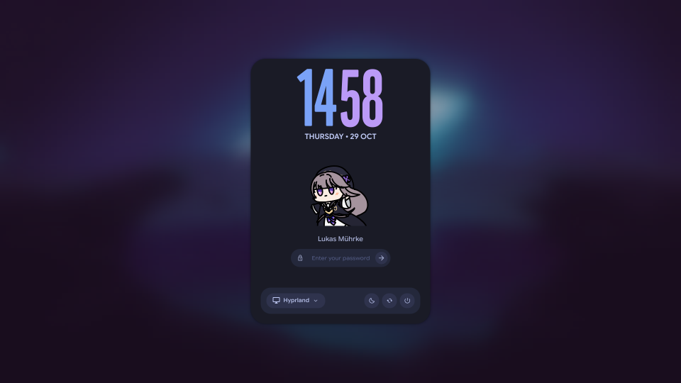

# SDDM theme

A login screen for SDDM in the look of the lock screen: the blurred wallpaper, a rounded panel with the clock, the
picture and the password pill whose characters pop in as shapes, plus a session picker and suspend / restart /
shut down buttons. The colours are those of your current scheme and follow it when it changes.

- **Clock:** day, time and date use the fonts, outline, sizes and colours of the depth clock on the desktop, as the lock
  screen does. Without a depth clock layout it is the two-tone clock of the stock lock screen.
- **Picture:** the gif of the shell's session menu (`paths.sessionGif`), at its animation speed, a few times bigger than
  there. If you have a `~/.face`, that is shown instead, in a rounded square.



## Requirements

- SDDM 0.21 or newer (Qt 6), with Qt 6.7+ for the variable font axes
- `ttf-material-symbols-variable`, installed system-wide, for the icons. Without it the icons are plain glyphs
- `qt6-imageformats`, if your wallpapers are WebP
- `python3`, and `sudo` once for the install

## Install

```sh
extras/sddm-theme/install.sh
```

This copies the theme to `/usr/share/sddm/themes/caelestia`, selects it in `/etc/sddm.conf.d/caelestia.conf`, and sets up
a systemd user path unit that runs `sync.py` whenever the scheme or wallpaper changes. Preview it without logging out:

```sh
sddm-greeter-qt6 --test-mode --theme /usr/share/sddm/themes/caelestia
```

If `/etc/sddm.conf` sets `Current=` itself it wins over the drop-in; remove that line. `install.sh --uninstall` removes
everything again.

## What is kept in sync

SDDM runs the greeter as its own user, which cannot read your home directory, so `sync.py` copies what the greeter needs
into the theme folder. `install.sh` makes exactly these files writable for you, so no root is needed afterwards:

| File | Content |
| --- | --- |
| `theme.conf.user` | the colours of `~/.local/state/caelestia/scheme.json`, and the panel opacity of `shell.json` (`appearance.transparency`) |
| `background` | the current wallpaper. Video wallpapers are skipped and the panel sits on the surface colour |
| `fonts/time`, `fonts/day`, `fonts/date` | the font files of the depth clock, found with `fc-match` from the families in its `layout.json`. A family fontconfig does not have is left out and the theme's own font is used |
| `mascot` | the gif of the session menu. Installed with the default one (`assets/kurukuru.gif`) until the first sync |
| `faces/<user>` | your profile picture, `~/.face`, if there is one |

Options go in `~/.config/caelestia/sddm-theme.json` and are written to `theme.conf.user` by the next sync. Any key of
`theme.conf` works:

```json
{ "twelveHour": "true", "avatar": "mascot", "mascot": "/home/me/Pictures/cat.gif" }
```

`avatar` is `auto` (your picture if you have one, else the mascot), `mascot` or `face`. `mascot` names another image or
gif instead of the one of the session menu. The session menu's gif is looked up in the shell folder from
`CAELESTIA_SHELL_DIR` (set by install.sh to this checkout), `~/.config/quickshell/caelestia` and `/etc/xdg/quickshell/caelestia`.

## Differences to the lock screen

- The M3 shapes of the shell (`qt6-m3shapes`) are not available to the greeter. A profile picture is a rounded square
  instead of the clam shell, and the password characters morph between a few simple shapes.
- The strings are English only.
- Other users get the mascot too. SDDM's own default picture is not used, as it would hide it.

## Tested

Headless with Qt 6.12 and software OpenGL, with mocked `sddm`, `userModel`, `sessionModel` and `keyboard` objects: idle,
typing, showing the password, a failed login, Caps Lock, the login in flight, the session list, switching users, the
power buttons, 12 hour clock, a scheme, fonts and mascot read from an installed `theme.conf.user`, a profile picture, and
1280x720 to 2560x1440. The depth clock fonts were tried with stand-in fonts, since Anurati and Michroma are not on the test
machine. Not tested in a running SDDM.
